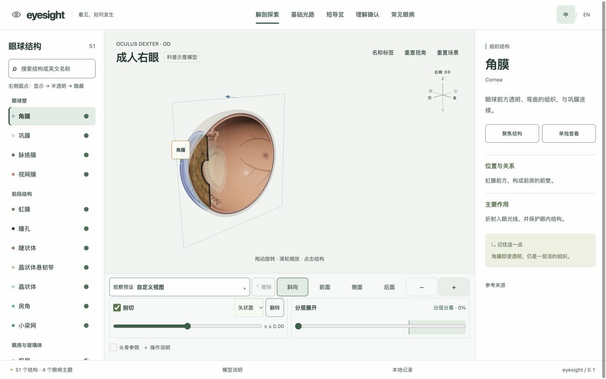

<div align="center">
  

# eyesight

**看见，如何发生。**

交互式眼球解剖、光路与常见眼病科普，让医生边操作、边讲解。

[在线体验](https://tipsypotato.github.io/eyesight/) · [功能亮点](#功能亮点) · [快速开始](#快速开始) · [功能进展与待办](docs/development-status-2026-10-22.md)

</div>



eyesight 是一个纯前端 3D 科普工具。医生可直接选择结构或疾病主题，指认位置、调整模型、比较正常与变化；患者和公众通过可视化理解讲解。无需账户或后端，支持中英文与桌面、手机布局。

> [!IMPORTANT]
> 本项目用于科普示意。几何、光学和疾病效果未经临床标定，不提供诊断、处方或疗效预测；医学内容仍待专家审核。

## 功能亮点

| 工作区 | 主要能力 |
| --- | --- |
| 解剖探索 | 成人右眼 51 个组织/区域/空间；眼外肌、结膜、眼睑、眼眶与内容物，头骨位置参照；搜索、图层、隔离、关联观察、十种预设、三轴剖切与分层/平铺 |
| 基础光路 | 正常聚焦、轴性近视、镜片矫正；五类参数、二维/三维同源光路、同条件对照；瞳孔、调节及神经信号演示 |
| 短导览 | 三条导览、11 步及 11 项可选观察操作，可随时返回探索 |
| 理解确认 | 共 29 道结构、导览及眼病题，独立会话、解释与错题回顾 |
| 常见眼病 | 白内障、青光眼、斜视、弱视；正常/变化切换、机制说明与可选题目 |

每次打开页面进入全部结构与头骨总览。眼部模型由程序生成，头骨使用随项目提供的 CC0 资产；先显示简化头骨，再补齐精细模型与虹膜纹理，加载失败时仍可操作眼球。

## 如何使用

1. 打开[在线体验](https://tipsypotato.github.io/eyesight/)，在“解剖探索”中搜索或点击结构，查看位置、作用与来源；通过观察预设、剖切和分层展开查看内部。
2. 切换“基础光路”调整参数、保存对照，或进入“常见眼病”比较正常与变化。短导览和理解确认题可按需使用，无需按课程顺序完成。
3. 桌面拖动旋转、滚轮缩放；手机默认上下滑动浏览页面，点击“操作模型”后旋转、双指缩放和拖动剖切框。右上角可切换中英文或打开 GitHub 仓库。

> [!NOTE]
> 语言、导览、题目及疾病记录只保存在当前浏览器，没有跨设备同步。刷新会回到全部结构总览并保留进度；清除浏览器存储后没有服务端备份。

## 快速开始

需要 Git、npm，以及 Node.js 22.12+（22.x）、24.x 或 26+。项目当前本地验证使用 Node.js 26.5.0、npm 11.17.0，CI 使用 Node.js 26；浏览器需启用 JavaScript 并支持 WebGL。

```sh
git clone https://github.com/tipsypotato/eyesight.git
cd eyesight
npm ci
npm run dev
```

打开终端输出的地址，默认为 [http://127.0.0.1:5173](http://127.0.0.1:5173)。开发服务只绑定本机，无需配置 API Key 或环境变量。

## 本地开发

| 命令 | 用途 |
| --- | --- |
| `npm run dev` | 启动开发服务，支持热更新 |
| `npm test -- --maxWorkers=1` | 运行全部 Vitest 测试，与 CI 一致 |
| `npm run typecheck` | 检查 TypeScript 类型 |
| `npm run build` | 类型检查并构建到 `dist/` |
| `npm run preview` | 预览已有构建，默认地址为 `http://127.0.0.1:4173` |

技术栈为 React、TypeScript、Three.js、Zustand、Vite 和 Vitest。内容与翻译均随应用提供，无运行时翻译服务。

主要目录：

| 目录 | 职责 |
| --- | --- |
| `src/anatomy/`、`src/content/` | 结构、关系、双语说明与题库 |
| `src/engine/` | 几何、渲染、相机、剖切、光学与眼病效果 |
| `src/state/`、`src/modes/` | 场景草稿、本地恢复、题目会话与演示状态 |
| `src/ui/`、`src/styles/` | 响应式工作区与操作面板 |
| `public/`、`scripts/` | 静态资产与虹膜资源生成脚本 |
| `docs/` | 功能说明、待实现及待验证清单 |

修改虹膜像素算法后，使用 Node.js 26 执行 `node scripts/bake-iris-textures.mjs` 更新预生成资源。每轮功能迭代同步更新[功能清单](docs/development-status-2026-10-22.md)并提交本地 Git；具体规则见 [AGENTS.md](AGENTS.md)。

## 部署

先运行 `npm run build`，再将 `dist/` 交给静态 HTTP 服务。资源使用相对路径，支持 GitHub Pages 的 `/eyesight/` 子路径；不能直接双击 `dist/index.html` 运行。

仓库已有 [GitHub Pages 工作流](.github/workflows/pages.yml)：推送到 `main` 或在 Actions 选择 `main` 手动运行后，安装锁定依赖、执行测试和构建（含类型检查），成功后发布 `dist/`。仓库 Settings → Pages → Source 需选择 **GitHub Actions**；检查失败不会更新站点。

线上版本以 [Actions](https://github.com/tipsypotato/eyesight/actions/workflows/pages.yml) 成功部署的提交为准。本地与线上记录各自独立；需要回滚时，将对应 `git revert` 提交推送至 `main`，通过工作流重新发布。

## 常见问题

- **头骨暂不可用或只显示简化版？** 眼球仍可操作。精细模型加载失败会保留简化参照，可关闭再开启“头骨参照”重试。各阶段与资源说明见[启动与渐进加载](docs/development-status-2026-10-22.md#启动与渐进加载)。
- **开发时出现 `504 Outdated Optimize Dep`？** 停止开发服务，运行 `npm run dev -- --force`，再刷新页面。另启临时 Vite 服务时必须使用独立 `cacheDir`，无需清空浏览器记录。
- **手机拖动时页面在滚动？** 这是默认浏览方式；点击“操作模型”进入旋转和缩放，退出后恢复滚页。

## 当前边界与后续计划

视网膜微观层级、场景链接、PNG 导出、展示模式和结构图鉴仍为可选待办；动态肌肉、眨眼、完整泪器和精细眶部网络尚未实现。详见[待实现及待验证清单](docs/development-status-2026-10-22.md#待实现及待验证清单)。

实际测试、构建、浏览器检查与发布记录集中在[验证范围](docs/development-status-2026-10-22.md#验证范围)。真实手机、低端 GPU、完整跨浏览器与读屏验收仍待完成；中英文的 LLM 对照审校不等于医学专家审核。

作者：tipsypotato · 代码采用 [MIT](LICENSE) · [第三方许可与来源](THIRD_PARTY_NOTICES.md)
